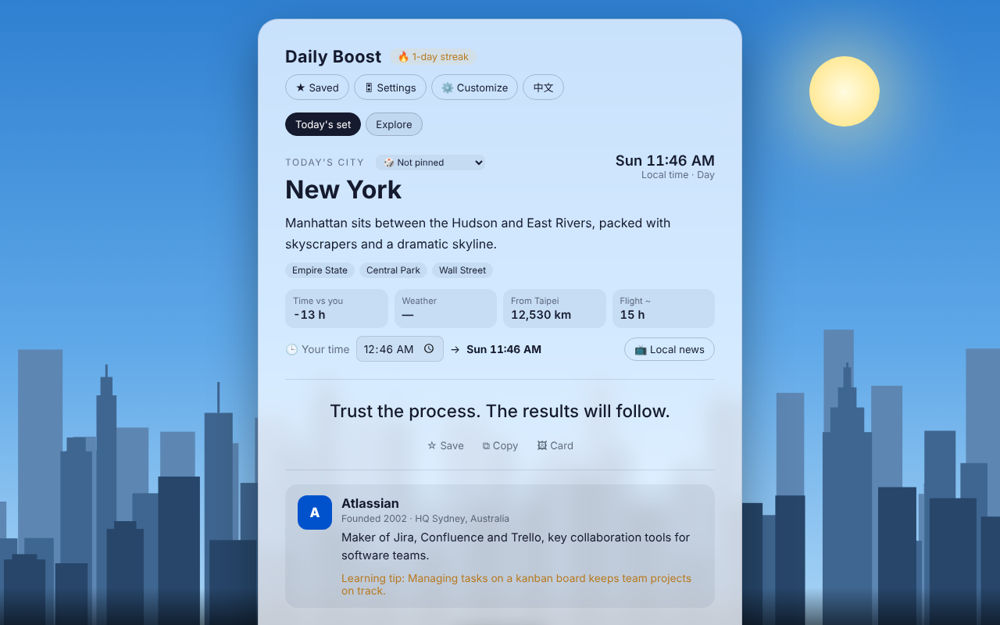
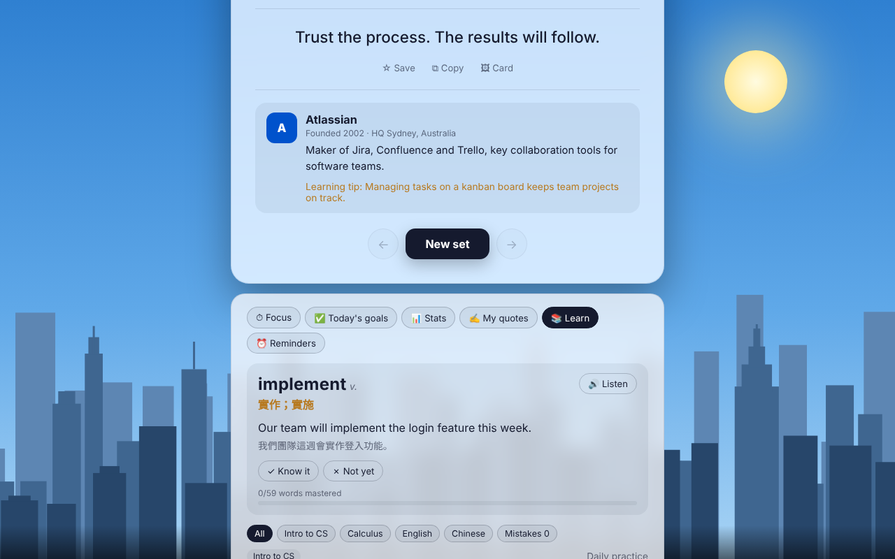
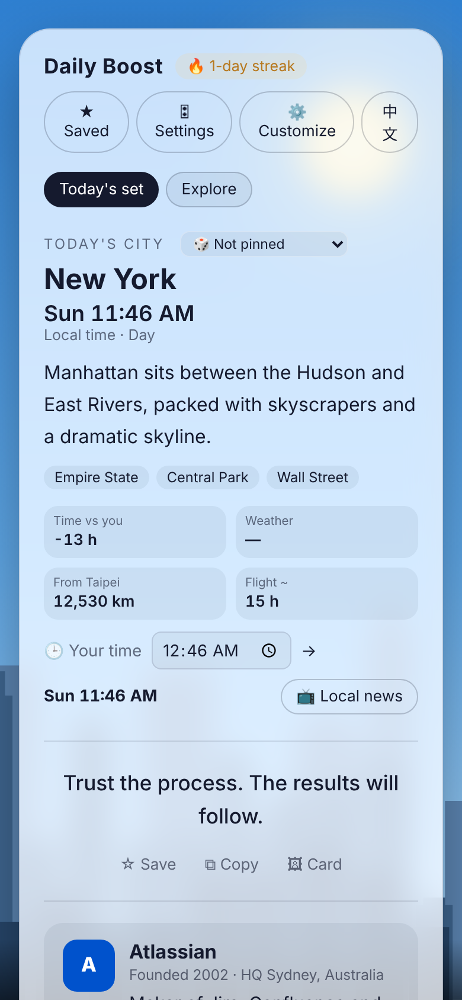

# Skyline Daily Boost

A daily encouragement page set against live city skylines. Every day you get a city, a quote and a tech company, plus small tools for focusing and practicing.

**Live site:** https://shiny-kleicha-085187.netlify.app

## Features

- **39 cities** (US and world) with real local time, live weather, time difference and links to local news stations
- **Sky that follows real time**: day, dawn, dusk and night per city, with stars, lit windows, shooting stars and real rain, snow or fog
- **Landmark silhouettes**: Empire State, Golden Gate, Taipei 101, Eiffel Tower, Big Ben and more
- **51 tech companies** from around the world with short profiles and learning tips
- **Focus timer** with ambient sounds (rain, waves, stream, white noise), zen mode and weekly stats
- **Daily goals, reminders** (with calendar export) and a daily review card
- **Practice**: daily word, 87 quiz questions by subject (number systems, logic, architecture, data structures, networks, databases, programming, calculus, English, Chinese), an endless mode with freshly generated questions, and a mistakes notebook
- **Customize**: add your own cities, companies, questions, words and quotes; export and import backups
- **Chinese and English**, light and dark themes, °C/°F, 12/24-hour clock
- **Installable** as an app (PWA) and works offline
- **Optional cloud sync and weekly leaderboard** with Firebase

## Tech

Plain HTML, CSS and JavaScript in one page, no build step. Weather from [Open-Meteo](https://open-meteo.com). Optional sync with Firebase Auth and Firestore.

| File | Purpose |
| --- | --- |
| `index.html` | The whole app |
| `sync.js` | Cloud sync and leaderboard (loads only when Firebase is configured) |
| `firebase-config.js` | Paste your Firebase web config here to turn on sync |
| `firestore.rules` | Security rules for Firestore |
| `sw.js`, `manifest.webmanifest` | Offline support and install-as-app |

## Screenshots

<p align="center">
  
  
</p>
<p align="center">
  
</p>

## Run locally

```bash
python3 -m http.server 8000
# open http://localhost:8000
```

## Turn on cloud sync (optional)

1. Create a Firebase project and enable **Google** sign-in under Authentication.
2. Add your site's domain under Authentication → Settings → Authorized domains.
3. Create a Firestore database and publish the rules from `firestore.rules`.
4. Register a web app and paste its `firebaseConfig` into `firebase-config.js`.

The Firebase web config is public by design; access is controlled by the Firestore rules and the Authorized domains list.
