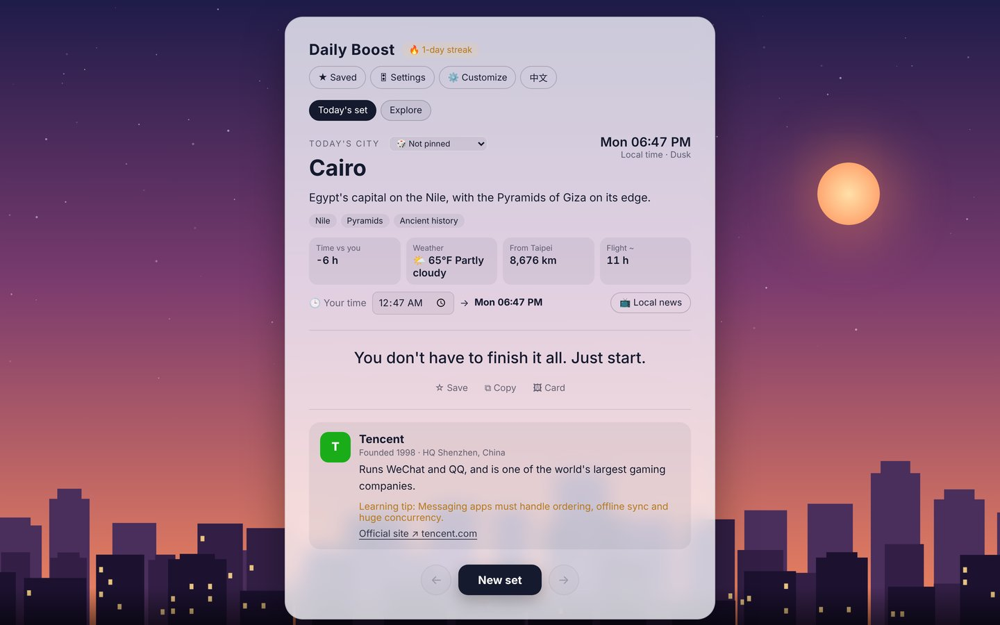
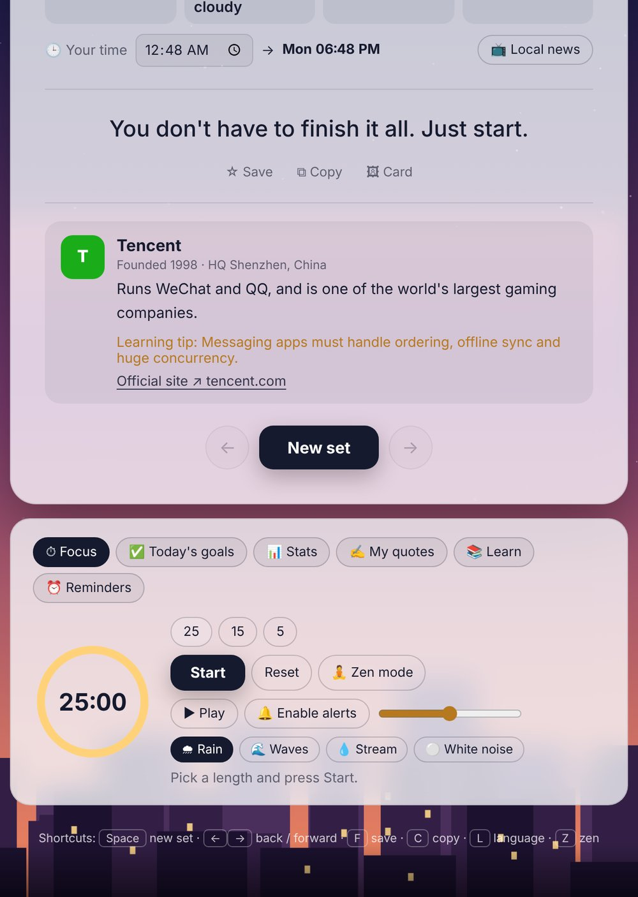
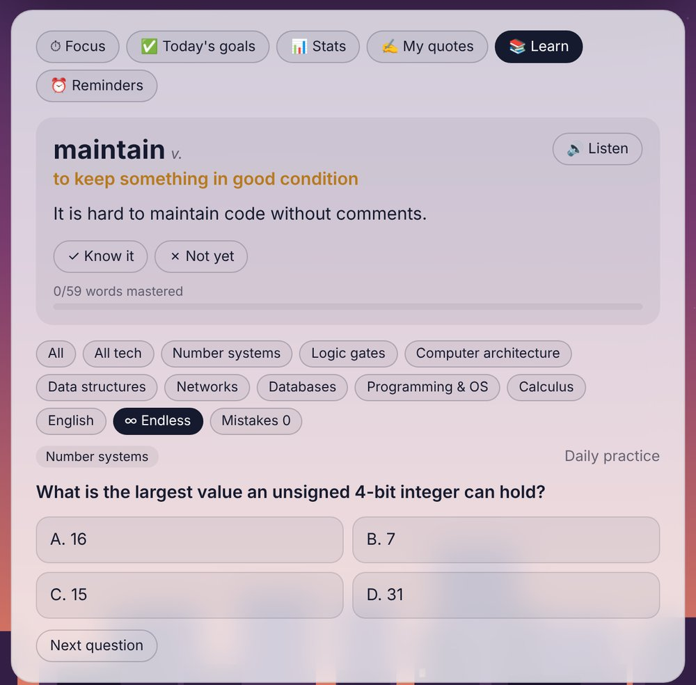
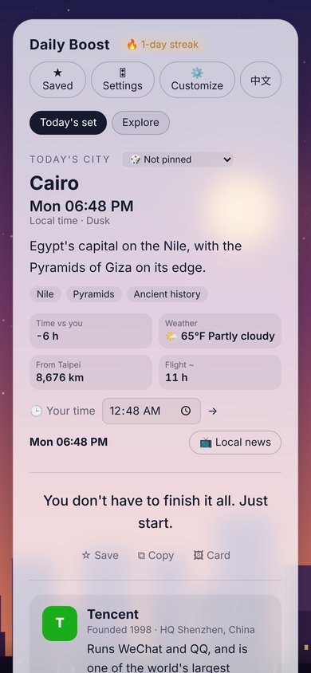
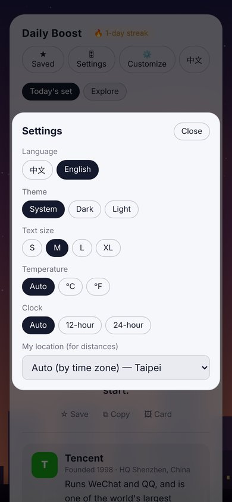

<p align="center">
  
</p>

<h1 align="center">Skyline Daily Boost</h1>

<p align="center">
  A city, a quote and a tech company every day, set against a live skyline.<br>
  Plus a focus timer, daily goals and endless practice quizzes.
</p>

<p align="center">
  <a href="https://black-tea666888.github.io/skyline-daily-boost/"><b>Open the live site →</b></a>
</p>

<p align="center">
  
  
  
  
  
  
</p>

<p align="center">
  
</p>

## What you get each day

| | |
| --- | --- |
| 🌆 **A city** | 39 cities across the US and the world, drawn as a skyline with landmark silhouettes. The sky follows the city's real local time: dawn, day, dusk, night, with real rain, snow or fog. |
| 🌤 **Live details** | Local time, current weather, time difference, distance and flight time from where you are, and a link to local news. |
| 💬 **A quote** | Short, practical encouragement. Save favorites, copy them, or make a share card. |
| 🏢 **A tech company** | 51 companies from around the world, each with a short profile, a learning tip and a link to its official site. |

## Tools for getting things done

<table>
  <tr>
    <td width="50%"></td>
    <td width="50%"></td>
  </tr>
  <tr>
    <td><b>Focus timer</b> with rain, waves, stream and white noise generated in the browser, zen mode, and weekly stats.</td>
    <td><b>Learn</b>: a daily word, 108 quiz questions by subject, an <b>∞ endless mode</b> that generates fresh questions, and a mistakes notebook.</td>
  </tr>
</table>

- **Quiz subjects**: number systems, logic gates, computer architecture, data structures, networks, databases, programming & OS, calculus, English
- **Daily goals** and a **daily review card**
- **Reminders** with calendar (.ics) export
- **Customize**: add your own cities, companies, questions, words and quotes; export and import backups
- **Settings**: English or Chinese, light or dark theme, text size, °C/°F, 12/24-hour clock, home location
- **Keyboard shortcuts**: <kbd>Space</kbd> new set, <kbd>←</kbd> <kbd>→</kbd> history, <kbd>F</kbd> save, <kbd>C</kbd> copy, <kbd>L</kbd> language, <kbd>Z</kbd> zen

## On your phone

<p align="center">
  
  &nbsp;&nbsp;
  
</p>

Open the site in Safari or Chrome and choose **Add to Home Screen**. It opens like an app and keeps working offline.

## How it's built

Plain HTML, CSS and JavaScript in a single page. No framework, no build step.

- **Skylines** are SVG generated in code; ambient sounds use the **Web Audio API**
- **Weather** comes from [Open-Meteo](https://open-meteo.com) (no API key)
- **Time zones** use `Intl.DateTimeFormat`
- **Offline**: a service worker caches the app and fetches updates first when online
- **Optional sync**: Firebase Auth (Google sign-in) and Firestore keep data in step across devices and power a weekly leaderboard

| File | Purpose |
| --- | --- |
| `index.html` | The whole app |
| `sync.js` | Cloud sync and leaderboard (loads only when Firebase is configured) |
| `firebase-config.js` | Firebase web config |
| `firestore.rules` | Firestore security rules |
| `sw.js`, `manifest.webmanifest` | Offline support and install-as-app |

## Run locally

```bash
git clone https://github.com/Black-tea666888/skyline-daily-boost.git
cd skyline-daily-boost
python3 -m http.server 8000
# open http://localhost:8000
```

## Use your own Firebase (optional)

1. Create a Firebase project and enable **Google** sign-in under Authentication.
2. Add your domain under Authentication → Settings → **Authorized domains**.
3. Create a Firestore database and publish the rules from `firestore.rules`.
4. Register a web app and paste its config into `firebase-config.js`.

The Firebase web config is public by design. Access is controlled by the Firestore rules and the authorized domains list. Set `window.SDB_FIREBASE = null` to keep everything on the device.

## Roadmap

- [ ] More endless question types (English vocabulary, networking)
- [ ] Push notifications for reminders
- [ ] More cities and companies

---

<p align="center">Made by <a href="https://github.com/Black-tea666888">Nick</a></p>
